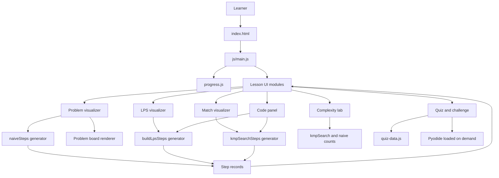

# KMP Explorer

An interactive, self-paced 45-minute lesson about substring search and the Knuth-Morris-Pratt (KMP) algorithm. Learners compare naive search with KMP, build the LPS table, trace mismatches, and apply the same idea to a new string problem.

**Duration:** 45 minutes

## The Problem and the Solution

Substring search looks simple until a partial match fails. A naive search moves the pattern one position and starts comparing from its beginning again, repeating checks it has already made. This is especially wasteful when the text and pattern contain repeated prefixes, such as searching for `AAAAB` in a long run of `A` characters.

KMP records each pattern prefix's longest proper prefix that is also a suffix in an LPS table. On a mismatch, it uses that overlap to move the pattern pointer `j` while leaving the text pointer `i` in place. The text pointer never moves backward, although a text character can be compared again after a fallback.

| Learning problem | What KMP Explorer makes visible |
|---|---|
| Naive search repeats work after a partial match | Module 1 steps through each alignment and counts comparisons and re-reads. |
| LPS is difficult to infer from its definition alone | Module 2 highlights the prefix and suffix as each table entry is built. |
| A mismatch fallback can feel like a magic jump | Module 3 animates the pattern shift and keeps the text index visible. |
| Linear complexity is easy to memorize but hard to justify | Module 5 connects pointer movement and fallback counts to the O(n + m) bound. |
| The algorithm may seem useful only for substring search | Module 6 applies LPS to the shortest repeating unit challenge. |

## System Architecture

The app is a static HTML page. `main.js` mounts the module views; algorithm generators produce step records; the UI renders those records and handles navigation, prediction, and playback.



| Layer | Responsibility | Main files |
|---|---|---|
| Lesson shell | Defines the six module containers and progress navigation | `index.html`, `js/main.js`, `js/ui/progress.js` |
| Algorithm core | Computes LPS/search behavior and emits inspectable steps | `js/core/kmp.js`, `js/core/naive-steps.js`, `js/core/stepper.js` |
| Module views | Turns input and current algorithm state into tables, boards, counters, and feedback | `js/ui/` |
| Lesson content | Holds copy, presets, questions, answers, and hints separately from rendering | `js/content/` |
| Styling | Supplies shared theme/layout styles and Module 1 board/control styles | `css/` |
| Validation | Checks algorithm behavior against fixed vectors and unit tests | `tests/`, `python/tests/` |

## Learner Workflow

| Stage | Learner action | System response |
|---|---|---|
| Start | Opens the lesson and chooses a module from the progress bar | `main.js` mounts the views; navigation displays one module at a time. |
| Observe | Selects a preset or enters text and pattern | The selected module creates a sequence of algorithm steps from the input. |
| Predict | Enters an LPS value, next event, or final comparison count | The module checks the prediction and explains the result. |
| Step through | In a step-driven module, uses Step, Back, Play, or Reset | The view renders the relevant step record; it does not calculate the algorithm independently. |
| Compare | Runs naive and KMP on the same input or changes the complexity slider | Comparison bars and worst-case curves show measured counts. |
| Apply | Answers the quiz and edits the repeating-unit Python starter | Feedback is shown immediately; Pyodide runs the hidden challenge tests when requested. |

### Step Data Flow

| Sequence | System operation |
|---:|---|
| 1 | A module accepts text and pattern input. |
| 2 | A core generator yields one object for each comparison, fallback, match, or completion event. |
| 3 | The module records the yielded objects and tracks the selected step. |
| 4 | The renderer draws cells, pointers, messages, counters, and highlighted code from that step. |
| 5 | Back, Step, Play, Reset, or a new prediction changes the selected record and triggers a redraw. |

---

## 1. What students will be able to do

By the end of the lesson a student can:

1. Explain why the naive substring search wastes work.
2. Define the LPS (Longest Proper Prefix which is also a Suffix) table and compute it by hand.
3. Trace KMP matching, including what happens on a mismatch and after a full match.
4. Write KMP in Python from memory.
5. Justify the O(n + m) time bound using the amortized argument.
6. Apply LPS to a new problem (shortest repeating unit of a string).

---

## 2. Lesson map (45 minutes)

| Min | Module | Concept | Interaction |
|-----|--------|---------|-------------|
| 0-5 | 1. The Problem | Naive search re-compares characters | Step through brute force on `AAAAB` in `AAAAAAAAB` with a live comparison counter |
| 5-15 | 2. The LPS Table | Prefix = suffix overlaps | Type any pattern; the table builds one cell at a time with the prefix and suffix highlighted. Predict-then-reveal mode |
| 15-25 | 3. The Matching Phase | Pointer `i` never moves back; `j` falls back via LPS | Step / play / back over custom text and pattern, with a mismatch-jump animation |
| 25-32 | 4. The Code | Python implementation | Step through the source with the active line highlighted; review common mistakes |
| 32-37 | 5. Complexity | O(n + m) time, O(m) space | Naive vs KMP comparison counts on the learner's own input, plus the amortized argument |
| 37-45 | 6. Check Yourself | Assessment | Quiz, "what happens next?" predictions, one coding challenge |

Every module follows the same loop: **see it, predict it, change the input, check it.**

---

## 3. Design decisions

- **Algorithm as a stream of steps.** `kmp.js` and `naive-steps.js` expose generators that yield records such as `{phase, i, j, lps, line, event, message}`. Views record these steps and render the selected state; they do not re-implement the search logic.
- **LPS gets its own module.** Most explanations treat the table as a given. Here it is a full interactive module because it is the hardest part.
- **Predict before reveal.** Learners commit to an answer (the next LPS value, the next pointer position) before the animation shows it.
- **Python is the reference.** The code module displays Python; the challenge runs learner-edited Python through Pyodide. JavaScript generators power the visual lesson.
- **No build step.** Plain HTML, CSS and ES modules. Anyone can clone, open `index.html` through a static server and it works.

---

## 4. Tech stack

| Layer | Choice | Why |
|-------|--------|-----|
| Markup / style | HTML5, CSS (custom properties, grid) | No framework needed; fast load; easy to review |
| Logic | Vanilla JavaScript (ES modules) | Generators map naturally onto algorithm steps |
| Visuals | DOM + CSS transitions; SVG for the complexity curve | Crisp, accessible, no canvas bookkeeping |
| Executable Python | [Pyodide](https://pyodide.org) loaded lazily from CDN | Runs real Python in the browser with no backend |
| JS tests | Node built-in test runner (`node --test`) | Zero dependencies |
| Python tests | `unittest` (standard library) | Zero dependencies |
| Hosting | GitHub Pages via GitHub Actions | Public link for reviewers |

Trade-offs: Pyodide is several megabytes on first use and needs internet, so the challenge runtime loads only when the learner runs the tests. The rest of the lesson uses local static assets.

---

## 5. Repository structure

```
kmp-explorer/
├── README.md
├── LICENSE
├── index.html                  # Single-page lesson shell
├── css/
│   ├── base.css                # Variables, typography, reset
│   ├── layout.css              # Page grid, module navigation
│   ├── components.css          # Shared controls and module components
│   └── problem.css             # Module 1 board, forms, and controls
├── js/
│   ├── main.js                 # Bootstraps modules, routing, progress
│   ├── core/
│   │   ├── kmp.js              # LPS builder, LPS/KMP step generators, search wrapper
│   │   ├── naive.js            # Naive search summary helper
│   │   ├── naive-steps.js      # Naive search as a step generator
│   │   └── stepper.js          # Records steps; play/pause/back/forward
│   ├── ui/
│   │   ├── problem-visualizer.js # Module 1 naive-search walkthrough
│   │   ├── problem-board.js    # Pure DOM board renderer
│   │   ├── lps-visualizer.js   # Module 2
│   │   ├── match-visualizer.js # Module 3
│   │   ├── code-panel.js       # Python source synced to step lines
│   │   ├── complexity-lab.js   # Module 5 counters and chart
│   │   ├── quiz.js             # Module 6 quiz and coding challenge
│   │   └── progress.js         # Module navigation
│   └── content/
│       ├── lesson.js           # Explanatory text per module
│       ├── problem-copy.js     # Module 1 copy and presets
│       └── quiz-data.js        # Questions, challenge, answers, and hints
├── python/
│   ├── kmp.py                  # Reference implementation
│   ├── challenges/
│   │   ├── repeating_unit.py   # Starter code for the challenge
│   │   └── solution.py
│   └── tests/
│       └── test_kmp.py
├── tests/
│   ├── kmp.test.js             # JS port tests
│   └── vectors.json            # Shared (text, pattern, lps, matches) cases
├── docs/
│   ├── lesson-plan.md          # Minute-by-minute plan and learning objectives
│   ├── instructor-guide.md     # How to teach it live
│   └── video-script.md         # Outline for the explanation video
└── .github/workflows/
    └── pages.yml               # Deploys to GitHub Pages
```

---

## 6. Running locally

```bash
git clone https://github.com/<your-username>/kmp-explorer.git
cd kmp-explorer

# any static server works (ES modules need http, not file://)
python3 -m http.server 8000
# open http://localhost:8000
```

Run the tests:

```bash
node --test tests/          # JS port
python3 -m unittest discover python/tests   # Python reference
```

---

## 7. The algorithm

### Why naive search is slow
It slides the pattern one position at a time and restarts comparison each time. Worst case O(n × m), for example pattern `AAAAB` in text `AAAAAAAA...`.

### The LPS table
`lps[i]` = length of the longest **proper** prefix of `pattern[0..i]` that is also a suffix of `pattern[0..i]`.

Example, `ABABC`:

| i | substring | lps[i] |
|---|-----------|--------|
| 0 | A | 0 |
| 1 | AB | 0 |
| 2 | ABA | 1 |
| 3 | ABAB | 2 |
| 4 | ABABC | 0 |

### Matching
Two pointers: `i` over the text (never decreases), `j` = length of the pattern currently matched.

- Characters match: `i++`, `j++`.
- Mismatch and `j > 0`: `j = lps[j-1]`, keep `i` unchanged.
- Mismatch and `j == 0`: `i++`.
- `j == len(pattern)`: record a match at `i - j`, then `j = lps[j-1]` to allow overlapping matches.

### Reference code (Python)

```python
def build_lps(p):
    lps = [0] * len(p)
    length = 0
    for i in range(1, len(p)):
        while length > 0 and p[i] != p[length]:
            length = lps[length - 1]
        if p[i] == p[length]:
            length += 1
        lps[i] = length
    return lps


def kmp_search(text, p):
    if not p:
        return []
    lps, j, matches = build_lps(p), 0, []
    for i in range(len(text)):
        while j > 0 and text[i] != p[j]:
            j = lps[j - 1]
        if text[i] == p[j]:
            j += 1
        if j == len(p):
            matches.append(i - j + 1)
            j = lps[j - 1]
    return matches
```

---

## 8. Complexity and why

**Time: O(n + m)**
- Matching: `i` increases n times and never decreases. `j` increases by at most 1 per iteration, so it rises at most n times in total. Every fallback `j = lps[j-1]` strictly decreases `j`, and `j` can't drop below zero, so total fallbacks ≤ total increases ≤ n. Matching is O(n).
- LPS construction uses the same argument on the pattern: O(m).

**Space: O(m)** for the LPS table. Matching itself uses O(1) extra space beyond the output.

The Complexity Lab lets learners confirm this empirically: enter any text and pattern and compare naive and KMP comparison counts side by side.

---

## 9. Edge cases covered in the lesson

| Case | Why it matters |
|------|----------------|
| Pattern longer than text | No match, and no index errors |
| Empty pattern | Defined behavior; handled explicitly |
| `AAAA` in `AAAAAAA` | Overlapping matches; reason for `j = lps[j-1]` after a match |
| Pattern with no repeated structure (`ABCD`) | LPS is all zeros, so KMP behaves like a plain scan |
| `ABCABC` | LPS shows a full-period repeat |
| No occurrence | Algorithm terminates cleanly |

---

## 10. Assessment

- **Knowledge checks:** multiple-choice questions with explanations (LPS definition, pointer behavior, complexity reasoning).
- **Predict-the-table:** compute the LPS for a given pattern before revealing.
- **What-happens-next:** given `i`, `j` and a mismatch, choose the next state.
- **Coding challenge:** *Shortest repeating unit.* Given a string `s`, return the shortest substring that repeats to form `s`, or `s` itself. Hint: use `n - lps[n-1]`. Tests run in the Pyodide playground.

---

## 11. Common mistakes (taught explicitly)

1. Falling back with `j = j - 1` instead of `j = lps[j - 1]`.
2. Forgetting to set `j = lps[j - 1]` after a full match, which loses overlapping matches.
3. Moving `i` backward on mismatch.
4. Using `lps[j]` instead of `lps[j - 1]` on fallback.
5. Allowing the whole substring as its own prefix/suffix (not "proper").

---

## 12. How a student uses the artifact

1. Open the page and follow modules 1 to 6 in order; the timer shows suggested pacing.
2. In each module, change the inputs and watch the visualization update.
3. Use the predict mode before pressing Step.
4. Finish with the quiz and the coding challenge.

For instructors, see `docs/instructor-guide.md` for talking points and pause points.

---

## 13. Testing strategy

- `tests/vectors.json` holds shared cases (including all edge cases above).
- `python/tests/test_kmp.py` and `tests/kmp.test.js` both load the same vectors, so the Python reference and the JS visualizer cannot silently diverge.
- A randomized test compares KMP against Python's `str.find` loop on random strings over a small alphabet.

---

## 14. Credits and academic integrity

Algorithm: Knuth, Morris and Pratt (1977). All code, copy, visuals and exercises in this repository were written for this submission; AI tools were used for brainstorming and review, and the author can explain every part of the implementation.

## License

MIT
